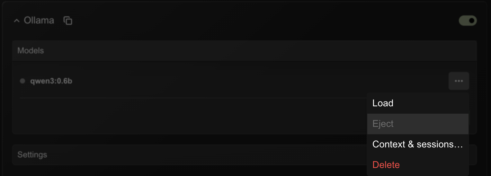
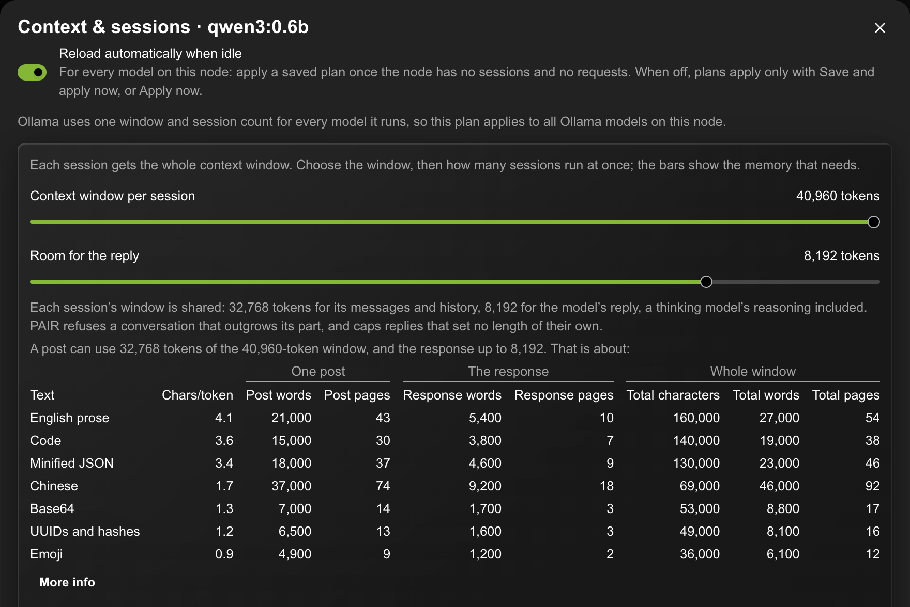
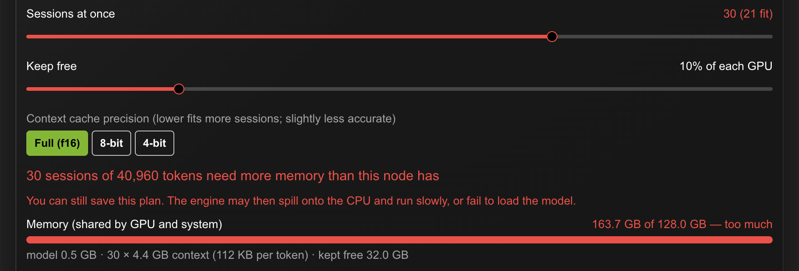
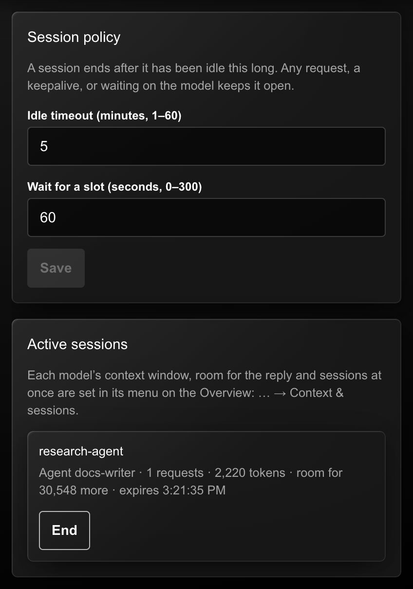
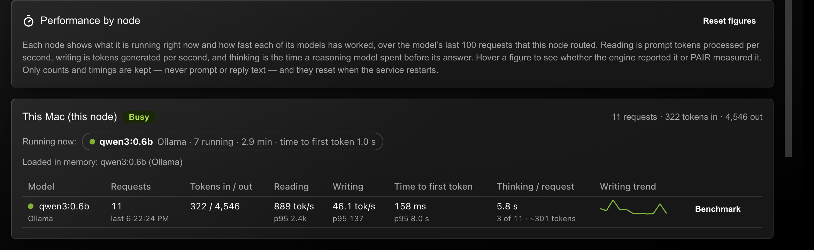

<!--
SPDX-FileCopyrightText: Copyright (c) 2026 NVIDIA CORPORATION & AFFILIATES. All rights reserved.
SPDX-License-Identifier: Apache-2.0
-->

# PAIR Plus

[](LICENSE)
[](SECURITY.md)
[](https://github.com/B-E-L-I-E-V-E/Personal-AI-Router-Pluss/releases/latest)

**PAIR Plus** is an independent fork of
[NVIDIA Personal AI Router](https://github.com/NVIDIA/Personal-AI-Router)
1.0.0, maintained at
[B-E-L-I-E-V-E/Personal-AI-Router-Pluss](https://github.com/B-E-L-I-E-V-E/Personal-AI-Router-Pluss).
It is not an NVIDIA product and is not supported by NVIDIA. Its window title
reads **NVIDIA PAIR Plus**; the installed app keeps the name NVIDIA PAIR, so an
existing installation's settings, cluster membership, and models carry over.

PAIR spreads independent requests across the machines on your network. PAIR
Plus makes that dependable for work that runs for hours across many agents: an
office of shared workstations, or a harness running long, distributed tasks.
Conversations stay on one node, every model has a known budget, and clients can
see how much room they have before they send.

The rest of this README is PAIR's own documentation and applies to PAIR Plus
unchanged unless noted. PAIR Plus nodes and NVIDIA PAIR 1.0 nodes work together
in one cluster.

## What only PAIR Plus does

| | NVIDIA PAIR 1.0 | PAIR Plus |
| --- | --- | --- |
| A conversation's turns | Each routed independently, possibly to a different node | Kept on one node as a **session**, so the engine reuses its cached prompt |
| Who owns a conversation | — | An **agent** (`X-PAIR-Agent-ID`); another agent is refused |
| How long it lives | — | Idle timeout, keepalive and an end call; ending cancels its requests |
| How many conversations a model serves | Whatever the engine was started with | **Sessions at once**, sized from the node's GPU and system memory |
| A conversation longer than the window | Ollama silently keeps only the last half | Refused with the exact token count, so nothing is lost unnoticed |
| Room for the answer | Not reserved | A **reply budget** kept in every window, so the model can always answer |
| Knowing before you send | — | Each session reports the room its next post has |
| Tracing a request | — | `X-Request-ID` on every request, response, job and log line |

### Sessions and agents

Send `X-PAIR-Session-ID` on each turn and PAIR sends it back to the node that
served the last one, so the engine reuses the conversation's cached prompt
instead of reading it again. Name the owner with `X-PAIR-Agent-ID` and no other
agent can use the session. A session ends after an idle timeout (10 minutes by
default), stays open for any request, a keepalive or a request still running,
and can be ended at once, which cancels its running requests.

### Context & sessions, per model

Each model's menu has **Context & sessions…**, a setting only PAIR Plus has.



Choose the context window every session gets, the room kept for the reply, and
how many sessions run at once. PAIR sizes them from the node's memory, reading
each model's cost per token from its architecture, and shows how much text
fits in one post, the response and the whole window.



Memory bars add up what the settings need. They turn red past what the node
has; such a plan can still be saved.



**Save and apply now** restarts Ollama or llama.cpp with a matching window and
session count; a saved plan can also apply itself once the node is idle.
Mixture-of-experts models can keep their expert weights in system memory on
llama.cpp, leaving the GPU for more sessions. When every session of a model is
taken, a new one goes to another node with the model, or waits in line.

### Room for the reply

A model reads and writes in one window: your messages, the conversation so far
and its answer. PAIR Plus keeps part of every session's window for the answer
(8,192 tokens by default), refuses a conversation that outgrows the rest
instead of letting the engine cut it silently, and caps replies that set no
length of their own. **Settings → Sessions** lists live sessions with the room
each one's next post has.



### Performance per model

The **Performance** tab, with the stopwatch icon next to **Settings**, has a
card per node: the models it is running right now, the models it has loaded,
and for each model it has served, tokens in and out, reading and writing speed
in tokens per second, time to first token and, for thinking models, the time
spent reasoning before the answer. **Run benchmark** is a per-model test: four
fixed prompts through PAIR, so models compare like for like. PAIR keeps only
the counts and timings, never the text.



### Use case: a harness for distributed agent work

PAIR Plus suits an agent harness that runs long tasks across an office's
machines:

- **It knows what exists.** `GET /v1/models` or `GET /api/tags` on a local
  PAIR endpoint lists the models held by every reachable node running that
  engine, so the harness can match each task to a model: a coding model for
  code, a small fast one for tool calls, a large one for planning.
- **It targets a task by model.** PAIR routes each request to a node that holds
  the model, so a task reaches the right hardware without the harness tracking
  machines. OpenAI-, Ollama- and Anthropic-style requests, tool calls included,
  pass through to the engine.
- **Each task is a session.** Give every agent task its own session and agent
  ID: its turns stay on one node with a warm cache, other agents cannot touch
  it, and ending the session cancels the task's running requests.
- **It plans against capacity.** `GET /pair/v1/capacity` gives each model's
  window, reply budget and sessions at once on a node, and
  `GET /pair/v1/sessions/{id}` gives the room a task's next post has, so the
  harness can split or summarize input before it is too big. A full model
  answers `503` with `Retry-After`, an overgrown conversation `400` with the
  numbers, never a silently cut prompt.
- **It knows what is fast.** `GET /pair/v1/performance` gives each model's
  reading and writing speed, time to first token and thinking time per node,
  measured from real requests or the built-in benchmark.
- **It traces everything.** `X-Request-ID` ties each answer to its job and log
  lines on whichever node ran it.

Read [Sessions and Context Capacity](docs/sessions.mdx) and
[Model Performance and Benchmarks](docs/performance.mdx) for the full API, and
the [API reference](fern/openapi.yml).

## About PAIR

NVIDIA Personal AI Router (PAIR), shown as **NVIDIA PAIR** once installed, is a
local inference router for a group of compatible computers on the same network. It discovers participating nodes,
manages supported inference engines, and presents local proxy endpoints for
Ollama-compatible, OpenAI-compatible, and Anthropic Messages API requests.
Independent requests can be routed to eligible nodes according to engine
availability, model availability, and current workload.

PAIR is useful for concurrent local workloads such as multi-agent applications.
Prompts and responses are intended to remain on the local network when every
configured client, model source, engine, and node is local.

> PAIR routes each independent request to one node. It does **not** pool GPU
> memory, combine GPUs into a larger logical GPU, shard one model across
> machines, or split an in-flight inference request between nodes.


*Two paired machines: requests arrive on one, run on whichever node suits each
one, and both report live GPU and memory use throughout.
[Watch the full clip](assets/pair-demo.mp4).*

## What is supported

| | |
| --- | --- |
| **Operating systems** | Windows 11; Linux; macOS |
| **Architectures** | x64 and arm64 on all three. Windows on ARM is experimental. |
| **Installers** | Windows `.exe`; Linux `.deb`; macOS `.dmg`. On other Linux distributions, [build from source](docs/building.mdx). |
| **Mixing nodes** | Windows, Linux, and macOS nodes can all be paired with each other |
| **Inference engines** | Ollama, LM Studio, and llama.cpp |

**PAIR running on a machine does not mean an engine will.** PAIR itself runs on
any supported Windows, Linux, or macOS machine. Each engine sets its own requirements
for the operating system, GPU, and drivers, and each model needs enough memory to
load. Whether a particular engine and model work on a particular machine is
between that engine and that machine, so check the engine's own documentation
before assuming a node can serve a model. A node only becomes a candidate for a
request once it is actually running a compatible engine, and PAIR prefers the
nodes it already knows hold the model.

## Quick start

Download a released build and use the desktop application. That is the path we
recommend and the one the rest of this guide assumes. Building from source and
the terminal interface both exist for good reasons — changing PAIR, and machines
with no desktop — but neither is the ordinary way in. Those are covered in
[Building and running PAIR from source](docs/building.mdx) and
[Terminal interface](docs/terminal-interface.mdx).

### Download a release

A released installer sets up the background services and the desktop
application together, and adds the firewall rules PAIR needs on Windows. It also
tells you when a newer release exists and installs it on your say-so from
**Settings → Service**. A build you make yourself is unsigned unless you sign it
(see [Building and running](docs/building.mdx#signed-macos-builds)), so you would
upgrade it by pulling and rebuilding.

Download PAIR Plus from its
[GitHub releases page](https://github.com/B-E-L-I-E-V-E/Personal-AI-Router-Pluss/releases).
The macOS builds are signed with a Developer ID and notarized by Apple. The
Windows and Linux builds are unsigned, so Windows SmartScreen may warn on first
install. NVIDIA's own signed releases of PAIR are on
[NVIDIA's releases page](https://github.com/NVIDIA/Personal-AI-Router/releases).
Release downloads include:

- a Windows installer;
- a Debian package for Linux; and
- a macOS disk image.

**On Windows and macOS,** double-click the download and follow the installer's
usual prompts — on macOS that means dragging **NVIDIA PAIR** to your
**Applications** folder.

**On Linux,** install the package from the directory you downloaded it into:

```bash
sudo apt install ./NVPAIR-Setup-*.deb
```

If you have kept more than one PAIR package in that directory, install the one
you want by its full filename instead.

### Run it

- **Open PAIR** the way you would any application — the Start menu on Windows,
  Launchpad or the Applications folder on macOS, your applications list on Linux.
  On a machine with no desktop environment, drive it from the
  [terminal interface](docs/terminal-interface.mdx) instead, which starts the same
  background services and gives you a full-screen view in the terminal.

- **Let it finish starting.** **Overview** shows this machine once the services
  are up. If it stays on **Loading...**, open **Settings → Service** and read the
  status there.

- **Get an engine running.** On the node's card, open **Engine settings** and
  select **Install** next to Ollama, LM Studio, or llama.cpp. PAIR downloads and
  sets the engine up for you, so nothing needs to be in place beforehand.

  

- **Add a model.** Select **Add model** on the same card and download one.
  `qwen4:12b` is used for this example; it can be replaced with a model of your
  choice. llama.cpp populates this list from popular GGUF repositories on
  Hugging Face. Type to filter the list, or press Enter to search the wider
  public catalog. Its exact IDs include the repository and quantization, such
  as `ggml-org/gemma-3-1b-it-GGUF:Q4_K_M`.

  

- **Send a request.** Two equally good options:

  - **Let PAIR generate the traffic.** Select **Test** on
    **Settings → Service** and PAIR sends a minute of inference through the same
    path, so you can watch the jobs appear without writing anything.

    

  - **Send one yourself.** Use the `curl` call below. The job then appears under
    **Jobs**, naming the node that served it.

With Ollama on its default port, this runs as written:

```bash
curl http://127.0.0.1:11434/v1/chat/completions \
  -H "Content-Type: application/json" \
  -d '{"model":"qwen4:12b","messages":[{"role":"user","content":"In one sentence, what does a router do?"}]}'
```

The reply is ordinary OpenAI-shaped JSON, abbreviated here:

```json
{
  "object": "chat.completion",
  "model": "qwen4:12b",
  "choices": [
    {
      "message": {
        "role": "assistant",
        "content": "A router decides where each incoming message should go and forwards it there."
      },
      "finish_reason": "stop"
    }
  ]
}
```

If you changed a port, or you are using LM Studio or llama.cpp rather than
Ollama, copy the URL from **Endpoints → API endpoints** instead of assuming the
one above.

That is a single machine working. To route across machines, pair a second one
from **Settings → Cluster** and repeat the engine and model steps there. The
inviting machine shows a six-digit PIN, and you enter that PIN on the machine you
invited.


The [Getting Started Guide](docs/getting-started.mdx) covers the same ground in
detail, plus pairing, ports, and connecting your own applications.

## Uninstalling

Removing PAIR and removing your data are separate steps, and the default is to
keep your data.

**Windows.** Uninstall from Apps & features, or the Start menu entry. The
uninstaller stops PAIR, removes its firewall rules, and asks whether to delete
your data. Decline and it stays; accept and it is removed.

**Linux.** `sudo apt remove nvpair` uninstalls the application and keeps your
data. Use `sudo apt purge nvpair` to remove the data as well. Run
`dpkg -l | grep -i pair` first if you need to confirm the installed package name.
A purge removes the engines PAIR installed under its own data directory, but not
one a vendor installer placed in your home, as LM Studio does — uninstall that
engine from PAIR before removing the package, or use its own uninstaller.

**macOS.** Run the uninstaller that ships inside the app bundle. It stops PAIR,
removes its firewall rules, unregisters its privileged helper, and then removes
the application:

```bash
sudo "/Applications/NVIDIA PAIR.app/Contents/Resources/installer-tools/uninstall-macos.sh"
```

An install from before the app was renamed is still called `PAIR.app`; use
`/Applications/PAIR.app` in the path instead. Add `--purge` to remove your data
as well. Dragging PAIR to the Trash instead
leaves the privileged helper registered, so use the uninstaller.

Your data means settings, logs, cluster identity and certificates, and any engine
PAIR installed for you. An engine the uninstaller cannot remove — one still
holding a file open, say — is left in place rather than stopping the uninstall;
remove it with its own uninstaller. **Model weights are not touched** — they live in the
engine's own storage (`~/.ollama`, `~/.llamacpp`, `~/.lmstudio/models`), so
removing PAIR does not delete the models you downloaded. Delete those through the
engine, or by removing its directory. An engine you installed yourself is also
left alone.

**To clear your data without uninstalling,** use **Settings → Service → Reset app
data**. It removes the same set — settings, logs, cluster identity and
certificates, and PAIR-installed engines — then restarts the application as if it
were newly installed. Model libraries are left alone here too. This is the quickest
way to start over after a broken cluster or a bad engine install.

If this machine belongs to a cluster, deal with membership too — otherwise the
other nodes keep listing it as a member. You have two options:

- **Leave from this machine** before uninstalling: **Settings → Cluster →
  Leave**, or press `l` on the terminal interface's **Nodes** tab and confirm
  with `y`.
- **Remove it from another node**, which any member can do from
  **Settings → Cluster** by removing that node from the list.

The second option works after the fact as well, so forgetting to leave first is
recoverable.

## Documentation

If you are new to PAIR, reading in this order will get you productive fastest.
Each entry assumes the ones before it.

1. **[Overview](docs/overview.mdx)** — what PAIR does and how its pieces fit
   together. Start here so the vocabulary in every other document makes sense.
2. **[Getting started](docs/getting-started.mdx)** — install it, pair two
   machines, prepare a model, and send a first request. This is the only document
   most users need. When you update, **[Release notes](docs/release-notes.mdx)**
   lists what changed and the **[Upgrade guide](docs/upgrade-guide.mdx)** covers
   any steps the update needs.
3. **[Managing engines](docs/engine-lifecycle.mdx)** — install, start, stop,
   update, and uninstall engines; what PAIR restores after you quit or relaunch.
4. **[Engine settings](docs/engine-settings.mdx)** — change an engine's ports and
   its launch command, on this machine or a paired one, and give a browser access
   to your models. Then **[Sessions and context capacity](docs/sessions.mdx)**
   covers PAIR Plus's request IDs, sessions, agents, and per-model capacity.
5. **[Terminal interface](docs/terminal-interface.mdx)** — the same tasks from a
   terminal, for a machine with no desktop environment. Skip it if every machine
   you run has a desktop.
6. **[Troubleshooting](docs/troubleshooting.mdx)** — worth skimming once before
   you need it, so you know where the diagnostics live. Alongside it,
   **[Known issues](docs/known-issues.mdx)** lists the significant limitations we
   are already aware of, and
   **[Collecting and sanitizing logs](docs/log-collection.mdx)** covers preparing
   a log you can share.
7. **[Architecture](docs/architecture.mdx)** — the process model, how a request is
   routed, and where the trust boundaries are. Read this before changing
   anything, or if you want to know why PAIR behaves the way it does.
8. **[Building and running](docs/building.mdx)** — prerequisites, building from
   source, running the services without the desktop application, and writing
   your own client against the JSON-RPC API.
9. **[Developer guide](docs/developing.mdx)** — read this before contributing:
   where the code lives, how a change travels through the layers, and the
   conventions the project enforces.

Component references, for when you already know what you are looking for:

- [Services](services/readme.md) — the background services, and from there each
  component's own reference
- [Desktop application](desktop/README.md) — working in the application, and from
  there its architecture, contracts, and CLI documentation

## Releases

See the [PAIR Plus releases page](https://github.com/B-E-L-I-E-V-E/Personal-AI-Router-Pluss/releases)
and [CHANGELOG.md](CHANGELOG.md) for what changed in each release. Releases are
built from version tags on `main` by the
[Release workflow](.github/workflows/release.yml); see
[Building and running](docs/building.mdx#publishing-a-pair-plus-release).

## Roadmap

These are features we want to add to PAIR. This list is a direction for the
project, not a commitment to delivery or implementation order. Community
feedback and contributions will help shape priorities.

### Platform support

- [ ] Full support for Windows ARM64 systems.
- [ ] DGX Station support.

### Engines and integrations

- [x] llama.cpp support.
- [ ] vLLM support.
- [ ] EXO support.
- [ ] ComfyUI integration.
- [ ] Unsloth support.
- [ ] Tailscale integration.

### Routing and clusters

- [ ] Route OpenAI-compatible API requests across different inference engines.
- [ ] Inference request queuing.
- [ ] Increase number of scheduler variables for better QoS.
- [ ] A "cluster as a node" view.
- [ ] KV cache-aware scheduling.

### Usability and reliability

- [ ] Requester-only clients that send work without hosting an inference engine.
- [ ] Launch PAIR automatically on system startup.
- [x] Configure engine launch options and environment variables from PAIR.
- [ ] Stability and reliability improvements informed by real-world use.

Have a feature request or a workflow you want PAIR to support? Open an
[issue](https://github.com/NVIDIA/Personal-AI-Router/issues) and tell us how you
would use it.

## Development Team

NVIDIA team members working on PAIR:

| Name | GitHub | Role |
| --- | --- | --- |
| Noah Tervalon (Terve) | [@Noah-Tervalon-Nvidia](https://github.com/Noah-Tervalon-Nvidia) | PAIR Developer - Community Lead |
| Chris Kelsey | [@ckelseynv](https://github.com/ckelseynv) | PAIR Developer - UI/UX Lead |
| Sherief Farouk | [@sherief-nv](https://github.com/sherief-nv) | PAIR Developer - Scheduling, Team Lead |
| Preston Goode | [@nv-pgoode](https://github.com/nv-pgoode) | PAIR Developer - Engine Management Lead |
| Kaylee Lubick | [@kjlubick](https://github.com/kjlubick) | PAIR Developer - Security Lead |
| Lucas Brodzinski | [@LB-NV](https://github.com/lb-nv) | PAIR Technical Program Manager |
| Ambrish Dantrey | [@adantrey](https://github.com/adantrey) | PAIR Engineering Manager |
| Seth Schneider | [@NV-sschneider](https://github.com/NV-sschneider) | PAIR Product Manager |

## Contributing and governance

- [Contributing](CONTRIBUTING.md)
- [Code of Conduct](CODE_OF_CONDUCT.md)
- [Governance](GOVERNANCE.md)

## Support

See [SUPPORT.md](SUPPORT.md) for public support channels and scope.

## Security

PAIR includes local HTTP endpoints, LAN discovery, a PIN-based trust bootstrap,
and cluster networking. Read [SECURITY.md](SECURITY.md) before deploying it on
an untrusted or shared network. Do not report vulnerabilities in a public issue.

## License

This project is licensed under the [Apache License 2.0](LICENSE). See
[Third-Party Software Notices](THIRD_PARTY_NOTICES.md) for bundled dependencies.
Inference engines, models, and other software used with PAIR may have separate terms.
