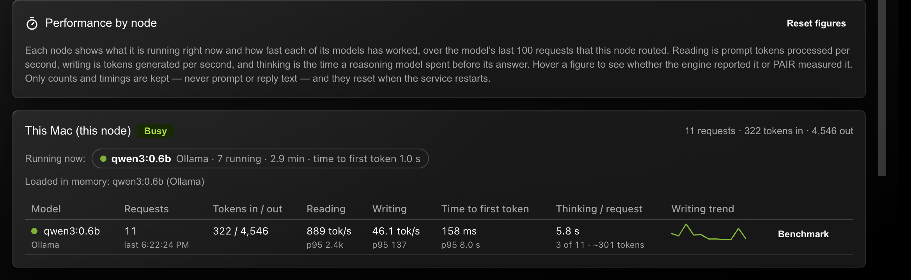
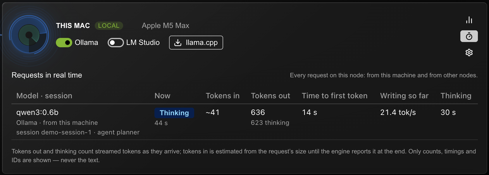
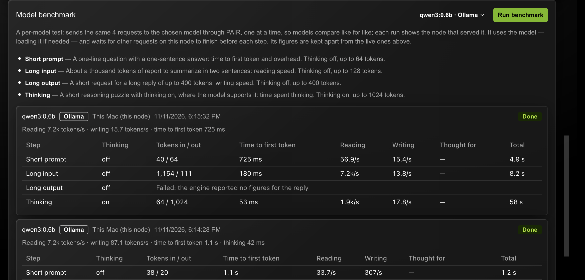

{/*
SPDX-FileCopyrightText: Copyright (c) 2026 NVIDIA CORPORATION & AFFILIATES. All rights reserved.
SPDX-License-Identifier: Apache-2.0
*/}

PAIR Plus measures every request it routes and shows how fast each node works.
The **Performance** tab, with the stopwatch icon next to **Settings**, has one
card per node: what the node is running right now, which models it has loaded,
and how fast each of its models has read prompts, written replies and thought.
A fixed per-model benchmark lets you compare models like for like.



## Each node, live

Every node in the cluster has a card, this node first. **Running now** lists
the models with requests running or queued on that node, with how many, for
how long, and the time to first token of the latest one (from when PAIR received
it, queueing included); it updates as jobs start and finish, the same way the Overview's job
list does, so it covers every node's work, not only this node's. **Loaded in
memory** lists the models the node's engines hold. Below them, a table gives one
row per model the node has served, with a pulsing dot on the models running now.

## Each request, in real time

Every node card on the **Overview** has a stopwatch button between the
performance bars and the settings gear. It opens **Requests in real time** for
that node, refreshed twice a second:



- **Running now**, one row per request: the model and engine, its session and
  agent IDs when the client sent them, whether it came from this machine or
  from another node, and its phase (waiting for a node, reading the prompt,
  thinking, answering) with how long it has run. Then tokens in (estimated
  from the request's size until the engine reports the real count at the end),
  tokens out so far with how many were thinking, time to first token, the
  writing speed so far and the time spent thinking so far.
- **Just finished**: the last few requests on the node with their final
  figures: tokens in with reading speed, tokens out, time to first token,
  writing speed and thinking.

On this node's own card the panel shows every request the node is serving,
including requests other nodes sent it. On another node's card it shows the
requests this machine sent there; requests that other nodes send to it appear
in their own app.

## What is measured

For each request that generates text (chat and completion routes on Ollama,
LM Studio and llama.cpp, and the Anthropic Messages route), PAIR records:

| Figure | Meaning |
|---|---|
| Tokens in / out | Prompt tokens and generated tokens, thinking included |
| Reading | Prompt tokens processed per second |
| Writing | Tokens generated per second |
| Time to first token | From sending the request to the node until the first token, thinking or answer, arrives |
| Thinking per request | For thinking models, how long the model reasoned before it began its answer, and roughly how many tokens that took |
| Load | Time the engine spent loading the model, where it reports it |

Each model row shows the average, with the slowest 5% (p95) beneath, over the
model's last 100 requests on that node, and a line of its recent writing speed.

PAIR keeps only counts and timings. It never stores, logs or shows the text of
a prompt or reply. The figures live in memory and reset when the service
restarts; **Reset figures** clears them sooner.

### Where each figure comes from

Hover a figure to see its source:

- **Reported by the engine.** Ollama reports how long it spent reading the
  prompt and writing the reply; llama.cpp reports the same in its `timings`.
  These are the most accurate figures.
- **Measured by PAIR.** Where the engine reports no timings (LM Studio, and
  OpenAI-compatible routes on Ollama), PAIR times the stream itself. Reading
  speed measured this way includes model loading and network time, so it reads
  lower than the engine's own figure. Time to first token and thinking time on
  a streamed reply are always measured by PAIR.
- **Estimated.** For a reply that is not streamed, thinking time and tokens
  are apportioned by how much of the reply was reasoning. For a stream that
  reported no token counts, tokens are counted from the stream.

Thinking is recognized in Ollama's `thinking` field, the OpenAI-compatible
`reasoning_content` and `reasoning` fields, Anthropic thinking blocks, and
`<think>` tags inside the reply.

### Which requests are covered

The speed figures cover the requests **this node routes**, on whichever node
serves them, so a model on another node appears under that node once you send
it requests through this node. Requests that other nodes route are measured on
those nodes, in their own app. Benchmark requests are kept apart and never
change the live figures.

## Benchmark

The benchmark is a per-model test. Choose a model in **Model benchmark** and
**Run benchmark**, or use **Benchmark** on a model's row. It sends four fixed
requests to the model through PAIR, one at a time, and records the same
figures; each run shows the node that served it:

| Step | Request | Thinking | Measures |
|---|---|---|---|
| Short prompt | A one-sentence question | Off | Time to first token |
| Long input | About 1,000 tokens of text to summarize | Off | Reading speed |
| Long output | A 300-word story | Off | Writing speed |
| Thinking | A short reasoning puzzle | On | Time spent thinking |

The benchmark uses the model: it loads it if it is not loaded and generates up
to about 1,600 tokens in all. Before each step it waits for other requests on
this node to finish, so it does not compete with your work, and it skips a step
if the node stays busy for two minutes. Only one benchmark runs at a time.

On LM Studio PAIR cannot switch thinking on or off, so every step runs with the
model's default. A model that cannot think shows the thinking step as skipped.



A step fails when the engine ends the reply with an error (Ollama's
"prediction aborted", for example), since a cut-off reply is not a fair
measurement. Each run shows its steps in a table and a summary line: reading speed from the
long-input step, writing speed from the long-output step, time to first token
from the short prompt and thinking time from the thinking step. The last 20
runs are kept until the service restarts. Runs on the same model through
different nodes, or on different models, can be compared directly because the
prompts never change.

## API

The same figures are available from any engine port on this machine:

```bash
curl -s http://127.0.0.1:11434/pair/v1/performance
curl -s -X POST http://127.0.0.1:11434/pair/v1/performance/benchmark \
  -d '{"model":"qwen3:0.6b"}'
curl -s -X DELETE http://127.0.0.1:11434/pair/v1/performance
```

`POST …/benchmark` runs on the engine whose port you call and answers `202`
with the run; poll `GET /pair/v1/performance` for its progress. See the API
reference for the full report.
