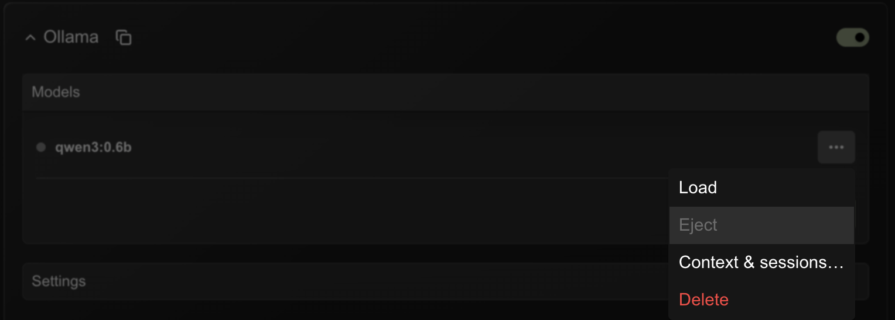
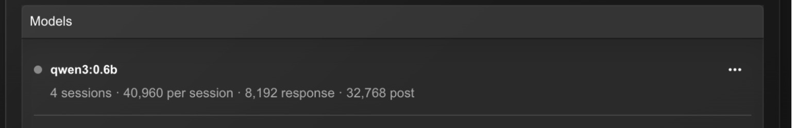
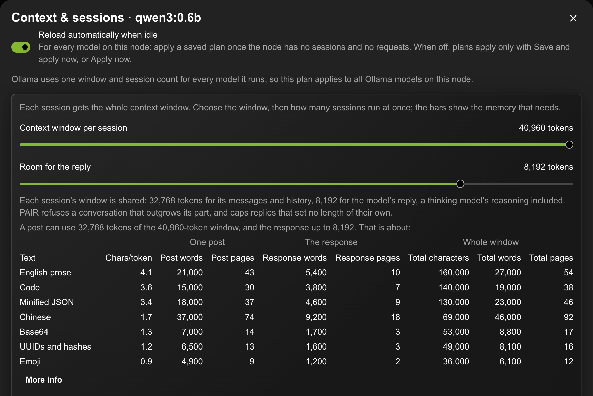
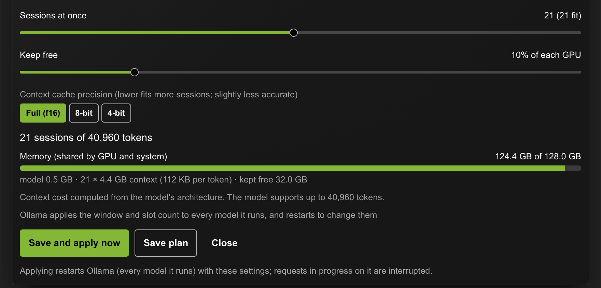
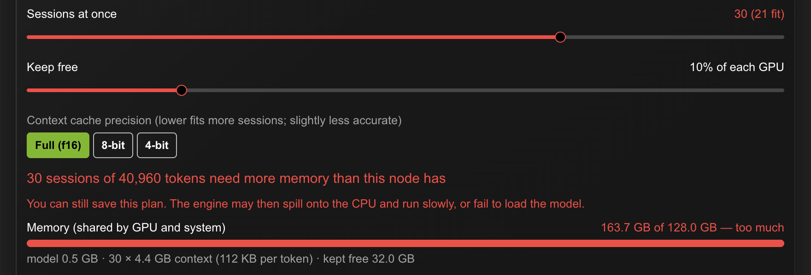
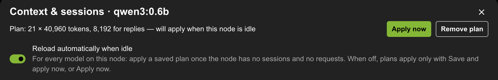
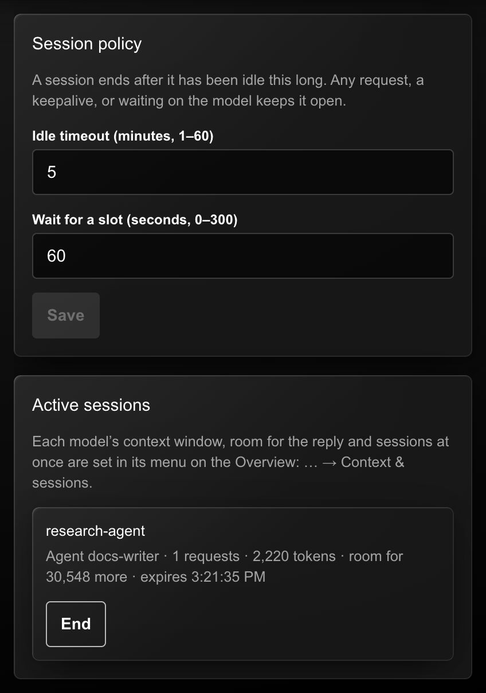

{/*
SPDX-FileCopyrightText: Copyright (c) 2026 NVIDIA CORPORATION & AFFILIATES. All rights reserved.
SPDX-License-Identifier: Apache-2.0
*/}

PAIR Plus adds four things to PAIR's routing: a **request ID** on every
request, **sessions** that keep a conversation on one node, **agent
ownership** of a session, and **context capacity**, which limits how many
sessions a model serves at once and how much context each may use. Everything
here is optional. A client that sends none of these headers is routed exactly
as in PAIR 1.0.

The engines PAIR fronts are stateless at the API level: the client resends the
whole conversation every turn. PAIR Plus does not store conversations either. It
holds only IDs, timestamps, the node serving each session, and the token counts
the engine itself reports.

## Request IDs

Every response carries exactly one `X-Request-ID`.

- Send your own (1–128 characters of letters, digits, `.`, `_`, `:`, `-`) to
  match a response to your logs.
- Otherwise PAIR creates a random ID.
- A value outside that format is replaced, never refused.

The same ID is forwarded to the engine and recorded on the job shown in
**Jobs**, so one value ties together your client, PAIR, and the node that
served the request.

## Sessions and Agents

Send the same `X-PAIR-Session-ID` on every turn of a conversation. Optionally
name the agent that owns it with `X-PAIR-Agent-ID`.

```bash
curl http://127.0.0.1:11434/api/chat \
  -H 'X-PAIR-Session-ID: research-42' \
  -H 'X-PAIR-Agent-ID: planner' \
  -d '{"model":"qwen3:0.6b","stream":false,"messages":[{"role":"user","content":"Hi"}]}'
```

With the OpenAI Python SDK, pass the headers once on the client:

```python
from openai import OpenAI

client = OpenAI(
    base_url="http://127.0.0.1:1234/v1",
    api_key="unused",
    default_headers={"X-PAIR-Session-ID": "research-42", "X-PAIR-Agent-ID": "planner"},
)
```

- **The first request creates the session.** Its agent, or none, owns it.
- **Each turn goes back to the node that served the last one**, so the engine
  reuses the prompt it already evaluated instead of recomputing it. If that node
  no longer has the model or fails, the turn goes elsewhere and the session
  follows it. A manual node selection still wins.
- **Ownership is checked.** A request naming a different agent, or none when an
  owner exists, gets `409`. A malformed header gets `400`. Loopback has no
  authentication, so this guards against two agents colliding on one ID, not
  against a hostile program on the same machine.

## How Long a Session Lasts

A session ends after it has been **idle** for its timeout: **10 minutes** by
default, adjustable from 1 to 60 minutes.

These keep a session open:

- any request for it;
- `POST /pair/v1/sessions/{id}/keepalive`;
- a request still running or waiting for a slot. A session never expires in the
  middle of a long generation.

When a session ends, by timeout or by `DELETE`, PAIR removes it completely,
cancels any of its requests still running, and frees its capacity. Reusing its
ID afterwards returns `410 Gone`, so an agent knows its session is over instead
of silently starting a new one under the same name. Each response carries
`X-PAIR-Session-Expires-At`.

## Context Capacity

PAIR Plus reads the token counts each engine reports (Ollama's
`prompt_eval_count` and `eval_count`, OpenAI-style `usage`, Anthropic `usage`)
and records each session's size: prompt plus completion after its last turn.
For a streamed OpenAI-compatible **session** request, PAIR asks the engine to
include usage (`stream_options.include_usage`), which adds one standard usage
chunk at the end of the stream. Requests outside a session are forwarded
exactly as sent.

A context window belongs to one conversation: every session gets the model's
whole window, and the node's memory decides how many sessions run at once. Each
model has its own **context window per session** and **sessions at once**, set
from GPU memory as described below.

### Messages and the Reply Share One Window

A session's window holds everything the model reads and writes: your messages,
the conversation so far, and the reply, a thinking model's reasoning included.
There is no separate limit per message; a message may use whatever the window
has left after the conversation and room for the reply. With a 40,960-token
window and 8,192 kept for the reply, a session's messages and history can use
32,768 tokens.

Engines handle a conversation that does not fit badly. Ollama accepts it and
keeps only the last half of the window, answering as if nothing were lost; a
reply with no length of its own keeps going past the window by forgetting the
start of the conversation. So for session requests on a node with a reply
budget, PAIR:

- sets `"truncate": false` on Ollama's own endpoints (`/api/chat`,
  `/api/generate`), so Ollama refuses a conversation longer than the window
  with its exact token count instead of cutting it. Ollama's OpenAI-compatible
  endpoints have no such switch;
- caps a reply that sets no length of its own at the reply budget
  (`options.num_predict` on Ollama's endpoints, `max_tokens` on
  OpenAI-compatible ones). Values the client set are kept;
- refuses, with `400`, a next turn once the conversation PAIR last measured
  has used the messages' share, naming the window, the reply budget and what
  is left, so the sender can shorten the conversation;
- reports `X-PAIR-Context-Reply-Tokens` and `X-PAIR-Context-Message-Limit`
  with `X-PAIR-Context-Session-Limit` on every reply it serves.

Requests outside a session are forwarded exactly as sent.

Where you set nothing, PAIR fills in what the local engine reports: Ollama's
per-request window, LM Studio's context length and parallel count, llama.cpp's
per-slot context and slot count. A value the engine does not report stays
unknown rather than guessed.

### Plan from GPU Memory

PAIR works out how many sessions fit in a node's GPU memory. On the
**Overview**, open a model's menu (**…**) in its engine's model list and select
**Context & sessions…**. This dialog is the one place a model's capacity is
set, for a model on this node or on any other node in the cluster. For Ollama, the window and session count apply to every
model Ollama runs, so planning one Ollama model replaces another's plan.



Each model row shows, under the model's name, what the router enforces for it: sessions at once (with how many are in use or waiting), the
context window per session, the response context kept for the reply, and the
post context left for a session's messages, for example `4 sessions (1 in use) ·
40,960 per session · 8,192 response · 32,768 post`. With no setting, the row
shows only what the engine reports, marked *as the engine reports*, or nothing
when the engine reports nothing. While a saved plan is not applied yet, the row
reads *Now:* for what is in force and a second line for the plan and its state.
The summary refreshes when you change a plan and every 15 seconds while the
Overview is open.

Models on other nodes show the same summary, for what *that* node enforces,
and its plan line: each node's router enforces its own capacity and keeps its
own plans, so this node's router asks the other node's over the cluster's
encrypted connection. Their summary refreshes every 15 seconds while the node's
**Engine settings** are open. A node that cannot be reached, or that runs PAIR
1.0, shows no summary.

### Planning Another Node's Models

Any cluster member can plan any other member's models, the same way it can
change that node's engines or pause it. Open **Context & sessions…** from a
model on another node's card: the dialog's title names the node, and
everything happens on that node.

- **Sizing.** The node that runs the model works out the plan: only it can read
  the model from its engine. It is sized for that node's GPUs and system
  memory, as its telemetry reports them, so the memory bars and red warnings are
  that node's.
- **Saving.** The plan is saved on that node, and that node enforces it.
- **Applying.** **Save and apply now**, or **Apply now**, restarts the engine on
  that node with the new window and session count, through the same path that
  edits that node's engine settings. For LM Studio, PAIR sets the limit on that
  node and tells you how to load the model to match.
- **Reload automatically when idle** is that node's own setting. PAIR on that
  node does the reload, so it needs the PAIR app running there; otherwise apply
  the plan from here.
- **Remove plan** removes it on that node and lifts the limit there.

When this machine cannot reach the other node's planner, **Context &
sessions…** says why instead of offering the sliders, with **Try again**. Two
things are needed:

- **PAIR Plus 1.3.1 or later** on that node.
- **Its firewall open to this machine** on the engine ports PAIR's cluster link
  uses: 11434 (Ollama), 1234 (LM Studio) and 8080 (llama.cpp), besides
  14318–14323. On Windows, from an Administrator Command Prompt, for a home
  network of `192.168.1.x`:

  ```bat
  netsh advfirewall firewall add rule name="PAIR engines" dir=in action=allow protocol=TCP localport=11434,1234,8080 remoteip=192.168.1.0/24
  ```

Pausing, stopping, **About this model…** and running a benchmark on that node
use the same link.



A model with no saved plan opens on what is in force for it, not on generic
values: the window, session count and reply length its engine runs it with
now, from the loaded model or the engine's launch settings, or else the
model's own defaults. A small marker beside each value says where it came
from (*engine now*, *engine settings*, *model default*, or *model maximum*
for the window the model was trained for) while the slider still sits there.
A value nothing reports keeps the planner's own default: as many sessions as
fit, and 8,192 tokens for the reply.

In the dialog:

1. Drag **Context window per session**. It stops at 2K, 4K, 8K and so on up
   to the model's maximum, which is the last stop. Every session gets this
   whole window.
2. Drag **Room for the reply** to set how much of each window is kept for the
   model's reply, a thinking model's reasoning included: 8,192 tokens by
   default, at most half the window. The rest is what a session's posts and
   history may use. Changing only this takes effect at once, without
   restarting the engine.



The table under the sliders follows them. For each kind of text it shows the
characters each token holds and, in three groups, how much fits in **one
post** (the window less the reply room), in **the response**, and in the
**whole window**, in words and pages, and in characters for the whole window.
The figures were measured with qwen3's tokenizer: ordinary English holds about
four characters a token, code about three and a half, while hashes, IDs,
encoded data and Chinese take about one token a character and emoji more than
one. A page is 500 words; counts are rounded down. **More info** explains the
conversions.

3. Drag **Sessions at once**. The label shows how many fit; the slider goes
   further so you can see what more would need.
4. **Keep free** sets the safety reserve, 10% of each GPU by default (at least
   1 GB each). On Apple silicon, where the GPU shares system memory, PAIR always
   keeps at least a quarter of it free for macOS.
5. Optionally pick a smaller **context cache precision**. 8-bit holds about
   twice as many tokens as full precision, 4-bit about three and a half times,
   at a small cost in accuracy.

As you drag, the memory bars show what the settings need:

| Bar | What it adds up |
| --- | --- |
| GPU memory | The model's weights in memory (on the GPU), sessions × one session's context, and the reserve |
| GPU 0, GPU 1, … | On a node with several GPUs, each GPU's layers of the model, its part of every session's context, and its own reserve |
| System memory | Expert weights kept there (see below), and a quarter of it (at least 4 GB) kept free for the system |



On Apple silicon the GPU and the system share one memory, shown as a single
bar.

#### Several GPUs

On a node with more than one GPU the engines split a model by layers: each GPU
holds whole layers, and each layer's part of the context cache stays on the GPU
that holds the layer. Every GPU you add adds memory for both the model and the
context, so a second GPU raises the window or the number of sessions, but each
GPU keeps its own reserve, and a session fits only when its part fits on every
GPU. PAIR splits the layers in proportion to the memory each GPU has after its
reserve, so a 24 GB and a 12 GB GPU take two thirds and one third, and sizes
each GPU on its own. The dialog shows a bar per GPU, such as
**GPU 0 · RTX 4090**, beside the total, and says how the model is split; a GPU
that runs out turns red even while the total has room.

Ollama keeps a model on one GPU when the model and every session fit there, and
spreads it only when they do not, so for Ollama the bars show one GPU holding
everything until you choose more sessions than it holds.

Applying a plan on such a node also sets the split, and only there:

| Engine | Multi-GPU setting |
| --- | --- |
| llama.cpp | `--split-mode layer --tensor-split` with the layers per GPU, replacing your own split options |
| Ollama | `OLLAMA_SCHED_SPREAD=1` when the sessions need more than one GPU. PAIR never removes it once set, since spreading is harmless to a smaller plan |
| LM Studio | Not set; offload every layer and split across all GPUs when you load the model |

The dialog lists what applying will set below its buttons.

When the settings need more than the node has, the sliders and the bar turn
red. You can still save and apply such a plan; the engine may then spill onto
the CPU and run slowly, or fail to load the model.



#### Mixture-of-Experts Models

Mixture-of-experts models (Qwen3 30B-A3B, gpt-oss, Mixtral and others) keep most
of their weights in experts, of which only a few run per token. On a node with
its own GPU memory, **Keep expert weights in system memory** moves them to
system memory, so the GPU holds only attention and the context and fits more
sessions. Tokens come out slower, since the experts then run on the CPU.

PAIR reads the exact size of the expert weights from the model's tensor table.
The switch appears only where it helps:

| Engine | Expert offload |
| --- | --- |
| llama.cpp | Applied with `--cpu-moe` |
| LM Studio | Planned; turn on keeping expert weights on the CPU when you load the model |
| Ollama | Not available; Ollama has no setting for it |

On Apple silicon it is never offered: the GPU already uses system memory.

For example, two 32 GB GPUs with an 11 GB model leave about 46 GB for context.
A model that needs 192 KB per token fits 1 session of its full 128K window
(3 with an 8-bit cache), or 7 sessions if you lower the window to 32K.

#### The Model's Size and Context Cost

The plan rests on two figures about the model, each with a slider that snaps
to round values and an exact field beside it. Both start at what the model
reports; move the slider or type a value to override it, and the plan uses
yours. **Use the model's** puts it back. Overrides are not saved with the plan.

**Model weights in memory** is the memory the weights take once loaded: in
GPU memory, and in system memory for any part kept there. It is not the
download, though the two are often close. The dialog shows each size it knows
and says which one the plan uses:

| Size | What it is | Where PAIR reads it |
| --- | --- | --- |
| Download size | The model on disk | Ollama's model list (`/api/tags`), LM Studio's model list, or the GGUF files added up for llama.cpp |
| In memory when loaded | The model's weight tensors added up, which is what they occupy once loaded: quantized GGUF weights load as stored | The tensor table, from Ollama's `/api/show` or the GGUF file |
| Loaded now | Everything a copy loaded in Ollama takes right now, the part on the GPU and its context: weights, context cache and working buffers together, so more than the weights | Ollama's `/api/ps` |

The plan uses the in-memory size when the tensor table gives it. When it
does not, as for MLX and other safetensors models, the plan uses the
download size as an estimate and says so. Quantized weights load at about
their download size; a 4B MLX model on Ollama took 4.1 GB loaded with a
4,096-token context against a 4.0 GB download. When the download holds more
than a tenth beyond the weight tensors, such as a vision projector that loads
too, the plan counts the download size.

Sizes are shown in binary units: 1 GB is 1024³ bytes. Ollama's own list
uses 1000³, so it shows a larger number for the same model; the 4B model
above is 3.7 GB here and 4.0 GB in `ollama list`.

**Context cache per token** is the memory each token of a session's
context keeps for its keys and values. PAIR computes it from the model's
architecture (attention layers × key/value heads × head size), counting only
the layers whose memory grows with the window, at full precision (f16). For
a model the engine does not describe, such as MLX models in Ollama, it
measures a loaded copy instead, at the engine's current cache precision, or
asks you for it. Under the slider the dialog shows what the plan counts at
the cache precision you chose, and what one session of the window needs.


**Save and apply now** restarts the engine with matching settings and then
limits PAIR's traffic to the plan:

| Engine | What changes |
| --- | --- |
| Ollama | `OLLAMA_CONTEXT_LENGTH` and `OLLAMA_NUM_PARALLEL`. These apply to every model Ollama runs, so one Ollama plan replaces another |
| llama.cpp | `--ctx-size` (window × sessions) and `--parallel` |
| LM Studio | Not restarted. PAIR limits traffic to the plan; set the same context length and parallel count when you load the model |

Restarting interrupts requests running on that engine. PAIR cannot restart an
engine it did not install, such as your own Ollama; it says so instead.

**Reload automatically when idle** (on by default) applies a saved plan by
itself once the node has had no sessions and no requests for two checks in a
row, about a minute. Turn it off to apply plans only when you press **Save and
apply now** or **Apply now**. The switch is in the dialog and covers every model
on the node. A saved plan's status shows at the top of the dialog, with **Apply
now** while it is pending and **Remove plan**, which also lifts the limit the
plan set.



### When Capacity Runs Out

A session takes one of a model's slots on the node serving it and keeps it until
it ends, expires, or moves.

- **Every slot held.** A new session's request goes to another node with the
  model. With no other node, it waits in line for a slot (60 seconds by default,
  up to 5 minutes), then gets `503` with `Retry-After`.
- **Session too large.** When a session's measured conversation has reached its
  limit (the window, less the reply budget when one is set) and the next request
  is not shorter, it gets `400`, naming the numbers.
  Shorten or summarize the conversation and send it again; a shorter request is
  accepted and measured afresh.

Responses carry `X-PAIR-Context-Session-Tokens` (the session's size before this
turn), `X-PAIR-Context-Session-Limit` (its share, when this node served it), and
`X-PAIR-Queue-Wait-Ms` (time spent waiting for a slot).

## Settings → Sessions

The desktop app's **Settings → Sessions** tab holds what is not per model:

- **Session policy:** idle timeout, and how long a request may wait for a slot.
- **Active sessions:** each with its size, the room its next post has, and an
  **End** button.

Each model's context window, room for the reply and sessions at once are set
in its menu, as described in Plan from GPU Memory.



The router saves these itself, so they survive restarts.

## Session API

Every PAIR endpoint port answers these, from this machine only:

| Call | Effect |
| --- | --- |
| `POST /pair/v1/sessions` | Create. Optional body `{"sessionId","agentId","idleTimeoutSeconds"}` |
| `GET /pair/v1/sessions[?agentId=]` | List live sessions |
| `GET /pair/v1/sessions/{id}` | Read one, including `expiresAt`, `context`, and a suggested `keepaliveIntervalSeconds`. For a session this node serves, each `context` entry also gives `windowTokens`, `replyTokens`, `conversationLimitTokens` and `postRoomTokens`, the room the next post has |
| `POST /pair/v1/sessions/{id}/keepalive` | Restart the idle clock |
| `PATCH /pair/v1/sessions/{id}` | Change `idleTimeoutSeconds` (60–3600) |
| `DELETE /pair/v1/sessions/{id}` | End now |
| `GET /pair/v1/capacity` | Each model's capacity and usage on this node, with `replyTokens` and `messageTokens`, the most a new session's first post may use |
| `PUT /pair/v1/capacity` | `{"engine","model","contextTokens","maxSessions","replyTokens"?}`, or `{"engine","model","clear":true}` |

An agent can size its posts from these: before the first turn, a post may use
the model's `messageTokens`; after it, `postRoomTokens` on the session.

The planner is available to the desktop through the proxy's JSON-RPC methods
`capacity/plan` (which takes and returns `replyTokens`, and returns
`postTokens` and, in `spec.defaults`, the window, slots and reply length the
engine runs the model with now or the model sets), `capacity/planner` and `capacity/planner-set` (plans carry
`replyTokens`).

Calls that change a session must send the owner's `X-PAIR-Agent-ID`. The
OpenAPI reference lists the full request and response shapes.

## Across Nodes

Every PAIR Plus node enforces its own capacity, including for sessions other
nodes send it. A cluster member reads another node's capacity from
`GET /pair/v1/peer/capacity` over mTLS, which answers the same report as
`GET /pair/v1/capacity` and refuses any other method. The desktop reads it
through the proxy's JSON-RPC method `capacity/peer-report` (`{"nodeId"}`).

A cluster member plans and changes another node's capacity through
`POST /pair/v1/peer/capacity/call` over mTLS, with
`{"method","params"}`. The node runs the method as its own desktop would and
answers `{"result"}`, or `400` with `{"error"}`. Only `capacity/report`,
`capacity/plan`, `capacity/planner`, `capacity/planner-set` and `capacity/set`
are accepted, and each change is logged with the calling member. The desktop
calls it through the JSON-RPC method `capacity/peer-call`
(`{"nodeId","method","params"}`); with no `nodeId`, or this node's own, the
method runs here. A full node waits briefly for a slot, then answers `503`, and the
sending node tries the next one. When a session moves to another node or ends,
the node it left frees the slot at once.

PAIR Plus and PAIR 1.0 nodes work together in one cluster. The extra headers
pass through a 1.0 node to its engine, which ignores them, so requests are
served normally. A 1.0 node does not enforce capacity, and a client that talks
to a 1.0 node directly gets 1.0 behavior.
